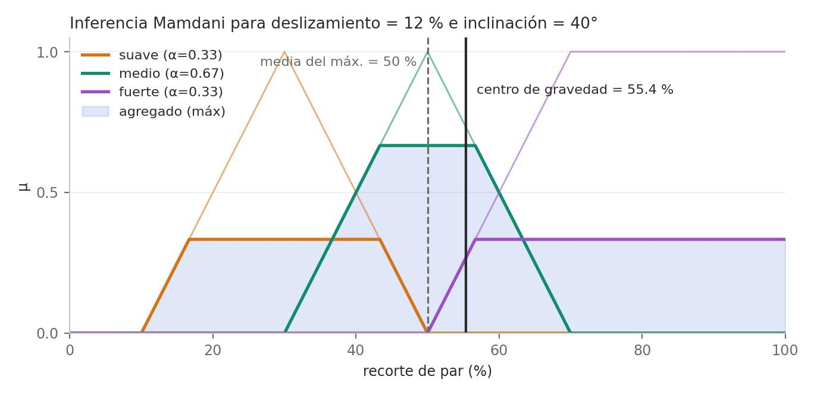
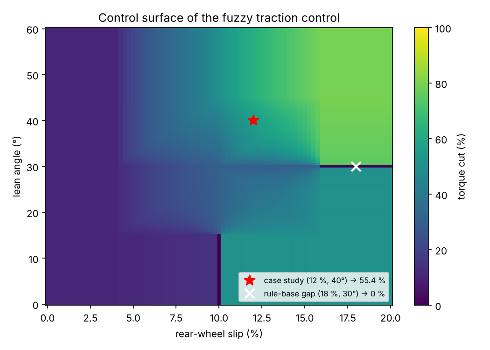
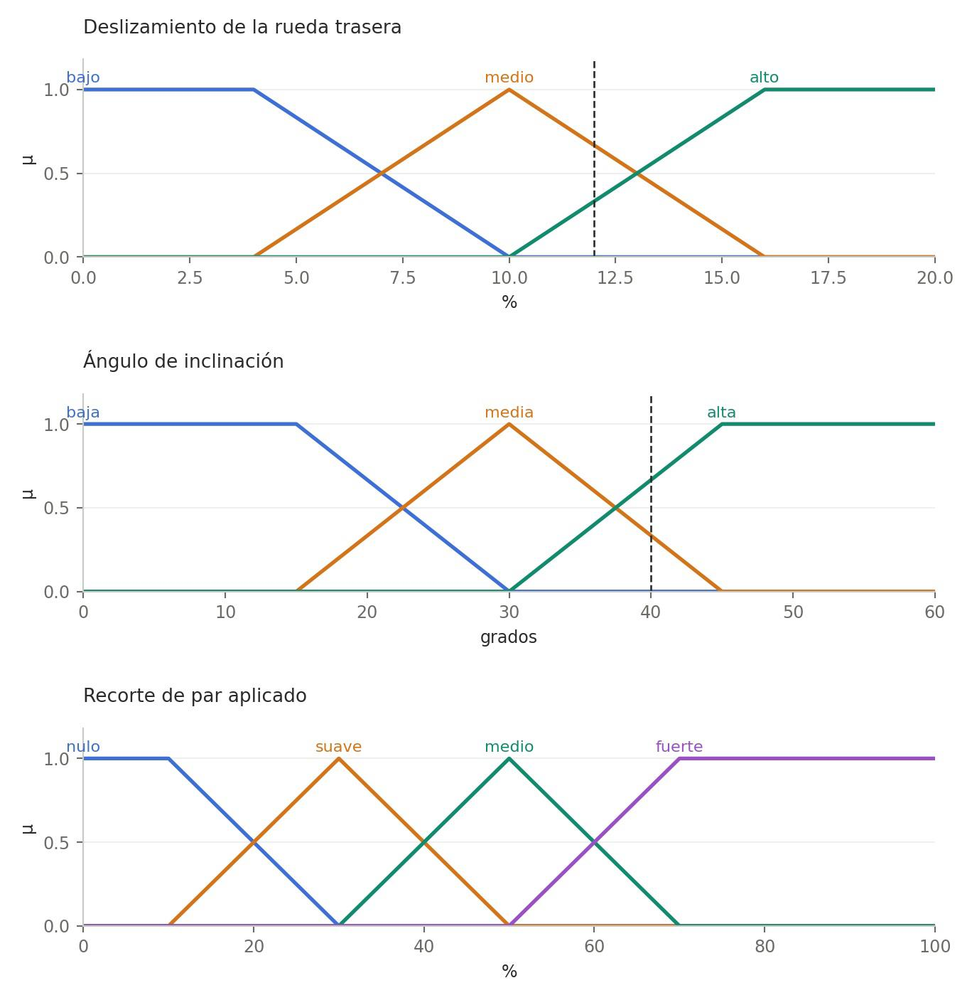
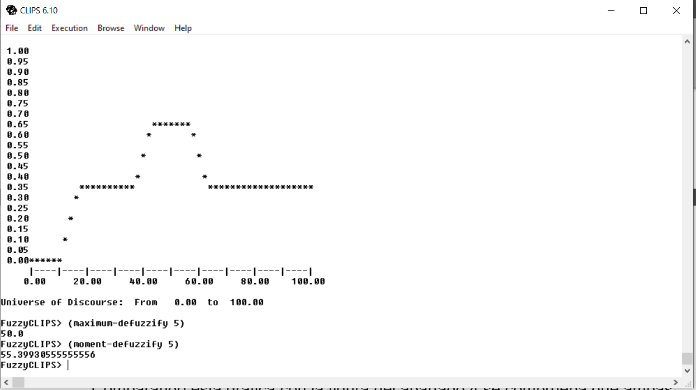

# Predictive Fuzzy Traction Control for Racing Motorcycles

**MSc Artificial Intelligence (VIU) · Approximate Reasoning**

A fuzzy logic controller that decides **how much engine torque the ECU should cut** when a rider opens the throttle while the bike is still leaned over. It combines two telemetry channels: **rear-wheel slip** and **lean angle**.

The system is built three ways and all three give the same answer:

1. **By hand:** fuzzy relations and Generalized Modus Ponens on discrete universes
2. **Mamdani inference** with fuzzy numbers, in **Python**
3. A rule-based expert system in **FuzzyCLIPS**

<p align="center">
  
  
</p>

> 🇪🇸 **Resumen:** Sistema borroso de control de tracción predictivo para motos de competición. A partir del deslizamiento de la rueda trasera y del ángulo de inclinación, decide cuánto par recortar para evitar un *highside*. Está implementado a mano (MPG), en Python (Mamdani) y en FuzzyCLIPS. La memoria completa está en [`docs/`](docs/).

---

## 🏍️ The problem

When a rider opens the throttle on corner exit, the bike is still leaned over and the rear tyre has a very small contact patch. A slide that would be harmless on a straight can end in a **highside** at full lean.

The knowledge a track engineer uses to tune traction control is naturally vague: *"high slip"*, *"very leaned over"*, *"soft torque cut"*. Fuzzy logic lets you write it down without forcing hard thresholds. Because the rules are linguistic, the controller is also **explainable**: you can read why the electronics stepped in.

| Variable | Type | Universe | Labels |
|---|---|---|---|
| Rear-wheel slip | Input | 0–20 % | low · medium · high |
| Lean angle | Input | 0–60° | low · medium · high |
| Torque cut | Output | 0–100 % | none · soft · medium · strong |

<p align="center">
  
</p>

## 📐 Rule base

| Rule | IF slip is… | AND lean is… | THEN torque cut is… | Meaning |
|---|---|---|---|---|
| R1 | high | high | **strong** | Recipe for a highside: maximum intervention |
| R2 | high | low | medium | Same slip but upright: controllable drift |
| R3 | medium | high | medium | Little contact patch available |
| R4 | medium | medium | soft | Fine correction |
| R5 | low | — | none | No slip, no intervention |

## ⚙️ Results: case study (slip 12 %, lean 40°)

| | Hand calculation | Python | FuzzyCLIPS |
|---|---|---|---|
| Rules fired (α) | R1 0.33 · R3 0.67 · R4 0.33 | same | same |
| Mean of maximum | 50.0 % | 50.0 % | 50.0 % |
| **Centre of gravity** | **55.4 %** | **55.4 %** | **55.40 %** |

**Centre of gravity** was chosen as the control action. Mean of maximum can jump from one label to another with a tiny change in slip, which would cause a **step in power delivery**: exactly what destabilises a leaned-over bike. Centre of gravity also picks up R1's partial highside warning, which is why the result (55.4 %) sits above the centre of *medium* (50 %).

The hand calculation also compares implication functions. **Łukasiewicz** leaves a "plausibility tail" that gives a 32.7 % cut where the rule says *don't intervene*. **Mamdani (min)** gives 8.3 %, which is why Mamdani is used for the actuator.

## 🔍 Limitations found with the control surface

Sweeping the whole input space (right-hand figure above) shows **gaps in the rule base** that a single case study does not:

- **Slip ≥ 16 % at exactly 30° lean → 0 % torque cut.** At 30°, lean belongs only to *medium*, and there is no rule for *high slip & medium lean*.
- **Slip = 10 % with the bike upright → 0 %.** Slip there is purely *medium*, and *medium slip & low lean* has no rule. A fraction of a percent more slip and the output jumps to 50 %.
- **Steps in the output**, e.g. upright bike with slip crossing 10 %. When only one rule fires, centre of gravity returns the centre of that consequent whatever its strength α.

**Next iteration:** complete the associative memory (add *high slip & medium lean → strong/medium* and *medium slip & low lean → soft*), then tune the membership functions with real telemetry.

Also out of scope: tyre wear and temperature, gear, track surface and slip dynamics (the controller has no memory).

## ▶️ Run it

```bash
pip install -r requirements.txt
python fuzzy_traction_control.py                    # case study: 12 % slip, 40°
python fuzzy_traction_control.py --slip 8 --lean 50 # any other input
python fuzzy_traction_control.py --plots            # regenerate the figures in images/
```

**FuzzyCLIPS 6.10d:**

```
(load "clips/BC_MotoGP.clp")
(load "clips/BH_MotoGP.clp")
(reset)
(run)
(plot-fuzzy-value t * 0 100 5)
(moment-defuzzify 5)      ; centre of gravity -> 55.40
(maximum-defuzzify 5)     ; mean of maximum   -> 50.0
```

<p align="center">
  
</p>

## 📁 Structure

```
fuzzy_traction_control.py   Mamdani engine (fuzzification, rules, aggregation, defuzzification) + plots
clips/BC_MotoGP.clp         FuzzyCLIPS knowledge base (linguistic variables + rules)
clips/BH_MotoGP.clp         FuzzyCLIPS fact base (case study)
docs/                       Full report (Spanish, PDF)
images/                     Figures
```

## 🛠️ Tech stack

`Python` `NumPy` `Matplotlib` `Fuzzy logic` `Mamdani inference` `Generalized Modus Ponens` `FuzzyCLIPS` `Expert systems`

---

**Author:** Julián Samblás Caballero · [LinkedIn](https://www.linkedin.com/in/julian-samblas-caballero-b3157a283/)
Related project: [Real-time telemetry device (bachelor's thesis)](https://github.com/JulianSamblas/realtime-telemetry-esp32s3)
